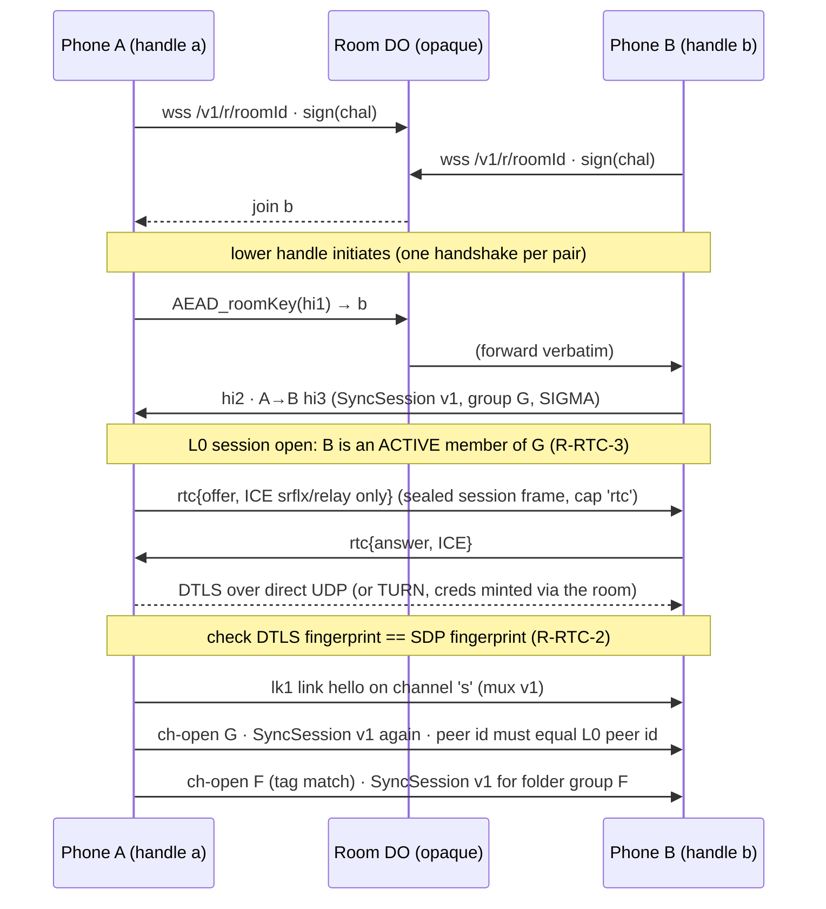
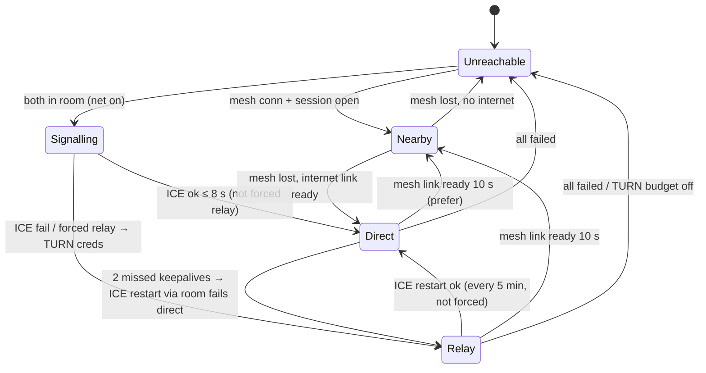
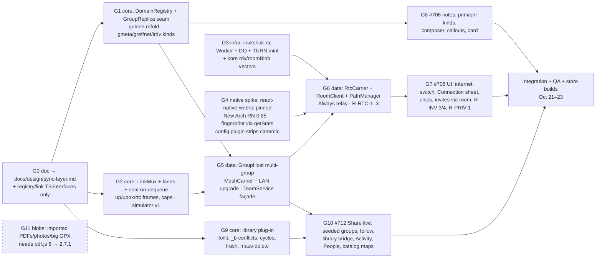

# Inukshuk 2.7.0: one generic phone-to-phone sync layer

**Status:** approved by the owner (2026-10-15), written before any code. PR G0 brings it into the repo; later PRs keep it current ("as built" notes are marked).
**Covers:** #705 (team over the internet), #706 (notes on the map), #712 (Share live). Future clients: shared routes and plans, a shared logbook, a trip between two of my own phones, live tracking for one contact.
**Binding inputs:**

- the owner's direction "generalise this phone synchronisation structure";
- the 2.7.0 security review (kept with the project's private notes): every one of its MUST requirements (`R-…` below) is binding, and §7 maps each one to a PR;
- the owner's 2.7.0 decisions (comments on #705, #706 and #712);
- the UI copy rule (no protective copy): the E2E line appears only in the Connection sheet.

Related: [`team-protocol.md`](team-protocol.md) (the v1 protocol this layer reuses byte for byte), [`team-mesh.md`](team-mesh.md) (the LAN transport).

---

## 0. Summary

**The team stack is already ~90 % of a generic sync layer.** Under the word "team", `src/core/team` contains:

- a signed, encrypted op envelope;
- per-author hash chains;
- an HLC;
- a membership fold with roles, cuts, invites and epoch keys;
- version-vector anti-entropy;
- per-field LWW CRDTs;
- capability records;
- a total, fuzzed session state machine.

What is team-specific is a thin band: the entity kinds and their authorisation (`data.ts`, `records.ts`, `tasks.ts`, `teamdraw/*`) and the views (`teamui/*`).

So the 2.7.0 work is **not a new stack**. It is four moves:

1. **Rename the concept, not the bytes.** A _sync group_ is what the code calls a team. The wire format, labels (`inukshuk/team/v1/…`), envelope v1 and session v1 stay byte-identical, so every 2.6.x peer keeps working. "Team" becomes one _domain_ on a group.
2. **Cut a domain-plug-in seam** through `data.ts`/`replica.ts`. The fold dispatches each `e.set`/`e.del`/`msg` by kind to a registered plug-in. The team domain is plug-in #1, the library domain (#712) is #2, and a "my phones" domain is sketched as #3.
3. **Add a link layer between transport and session.** It has one link per remote phone per path, carries many groups as channels, uses priority lanes, and seals frames at dequeue time so an SOS overtakes bulk sync. Its carriers are the existing LAN mesh, WebRTC direct and Cloudflare TURN, with rendezvous on a Durable Object in the separate free account.
4. **Run many groups at once.** Today one "active team" owns the transport (`TeamService`). It is replaced by a `GroupHost` that keeps every group the phone belongs to replicated whenever the app runs.

**Unknown kinds are already safe on old phones.** I verified this in code, which closes the security review's unverified item. An `e.set` with a kind a 2.6.x phone doesn't know:

- passes `checkEnvelope` (type `e.set` is known);
- is stored and **relayed**;
- is skipped by the data fold: `parseSetBody` returns `undefined`, and `applyDataOp` does `break`, with no strike. The session never decodes bodies.

This is the forward-compatibility hook the whole design rests on. New _envelope types_ and new _session frames_ are different: old peers strike on them. They go only to peers whose `cap` record advertises them, as `pen` does since 2.5.2.

```mermaid
flowchart TB
  subgraph Features["src/features + src/state"]
    TUI[Team screens<br/>teamStore]
    LUI[Library / Share live<br/>libraryStore bridge]
    FUT[Future: logbook, my phones,<br/>contact tracking]
  end
  subgraph Domains["Domain plug-ins (src/core/domains/*) — pure"]
    DT[team: pos, pins/notes, SOS, rally,<br/>trails, tasks, drawings, chat]
    DL[library: folders, items, manifests,<br/>moves, trash, conflicts]
    DS[self (sketch)]
  end
  subgraph Group["Sync group core (src/core/team → group) — pure"]
    REG[DomainRegistry]
    REP[GroupReplica<br/>OpLog · chains · HLC · membership · keyring]
    SES[GroupSession = SyncSession v1<br/>SIGMA · AEAD frames · vv/want/ops<br/>+ cap-gated: up, rtc, blob]
    LNK[LinkMux<br/>channels · lanes · padding]
    BLB[Blob engine<br/>manifest · chunks · verify]
  end
  subgraph Data["src/data/sync — platform"]
    HOST[GroupHost<br/>all groups, persistence]
    PATH[PathManager<br/>nearby ▸ direct ▸ relay]
    T1[MeshCarrier<br/>modules/inukshuk-mesh]
    T2[RtcCarrier<br/>react-native-webrtc<br/>direct or TURN]
    RDV[RoomClient<br/>WebSocket L0]
  end
  W[(inukshuk-rtc Worker + DO<br/>separate free CF account)]
  TUI & LUI & FUT --> HOST
  HOST --> REG --> DT & DL & DS
  HOST --> REP --> SES --> LNK
  BLB --> LNK
  LNK --> PATH --> T1 & T2
  PATH --> RDV --> W
  T2 -. TURN creds via room .-> W
```

---

## 1. What exists today, precisely

| Layer                   | Files                                                                                                                                                                                                                                      | Generic or team-specific                                                                                                                  | Notes                                                                                                                                                                                                |
| ----------------------- | ------------------------------------------------------------------------------------------------------------------------------------------------------------------------------------------------------------------------------------------ | ----------------------------------------------------------------------------------------------------------------------------------------- | ---------------------------------------------------------------------------------------------------------------------------------------------------------------------------------------------------- |
| **Transport**           | `modules/inukshuk-mesh/**` (Kotlin `MeshEngine/MeshProtocol/MeshDiscovery/MeshNetwork`, Swift `MeshEngine/MeshProtocol`), `src/data/team/{meshTransport,meshNative,loopbackMesh}.ts`                                                       | **Generic.** Opaque length-prefixed frames, `INKM` v1 preamble, DNS-SD `_inukshuk-team._tcp` with TXT `t=<tag>`, bans by IP, backpressure | No crypto native-side (verified by the review). One advert (one tag) at a time                                                                                                                       |
| **Connection plumbing** | `src/data/team/{meshLink,meshSessions}.ts`                                                                                                                                                                                                 | Generic                                                                                                                                   | `MeshSessionHost`: one `FrameSession` per connection, backpressure queue, tick, ban propagation. `MeshLink`: discovery and dial policy for **one** team                                              |
| **Crypto / identity**   | `core/team/{crypto,nobleCrypto,ids,bytes,canonical}.ts`, `data/team/teamCrypto.ts`                                                                                                                                                         | Generic                                                                                                                                   | **One device key pair per phone** (`TeamDisk.loadDevice`), so a member id is the same in every team. That makes per-peer links possible (§3.3)                                                       |
| **Membership / keys**   | `core/team/{membership,roles,keys,invite,actions,chain}.ts`                                                                                                                                                                                | Generic, with team vocabulary                                                                                                             | Roles `guest < member < admin < owner`; sub-groups (`g.set`) and audiences; epoch keys wrapped per member; forced rotation on removal; invites v1 (48 h single use by default); any member may admit |
| **Replicated op log**   | `core/team/{envelope,hlc,log,replica,crdt,ratelimit,sync}.ts`                                                                                                                                                                              | Generic, except that `replica.ts` calls `reduceData` and `capHolders` directly                                                            | Control / data / ephemeral classes; per-author `pv` chains; equivocation proofs; gap buffer; quarantine; fork-refold throttle; vv/want/ops anti-entropy; `PeerGuard`                                 |
| **Team domain**         | `core/team/{data,records,tasks,photos,notify}.ts`, `core/teamdraw/*`, `core/teamui/*`, `data/team/{teamSession,teamDraw,teamNotifications,teamPhotoFiles,simulatedTeammates}.ts`, `state/{teamStore,teamDrawStore}.ts`, `features/team/**` | **Team-specific**                                                                                                                         | Kinds `wpt point task track photo comment msg trl tve sos rly mres drw cap`; positions (`pos`), live strokes (`pen`); pins = `msg` on thread `pin:<owner>:<id>` with `ll`                            |
| **Runtime**             | `data/team/{teamService,teamSession,teamJoin,teamDisk,fsTeamDisk,persistingStore}.ts`                                                                                                                                                      | Mixed                                                                                                                                     | `TeamService` runs **one** `TeamSession` (the active team). Disk: `teams/<id>/ops.jsonl` plus `cursor.json`; team keys are re-unwrapped from the log on launch                                       |
| **Sync M0**             | `core/sync/*`                                                                                                                                                                                                                              | Unwired                                                                                                                                   | Single-user LWW for a server; its rules were lifted into `crdt.ts`                                                                                                                                   |

**Strictness that shapes everything:**

- `checkEnvelope` refuses unknown envelope fields and types.
- `SyncSession.onSealed` strikes unknown frame types (`default: strike 'protocol'`).
- Handshake frames are strict-keyed.

So the only zero-risk extension points toward 2.6.x are **new `e.set` kinds, new `msg` threads and new fields inside kind bodies**. Everything else must be cap-gated.

---

## 2. Transports (L0 + L1)

### 2.1 Vocabulary

- **Carrier:** something that moves ordered, reliable byte frames between two phones: the LAN mesh (TCP), a WebRTC data channel (direct, or forced through TURN), and the L0 room (signalling only).
- **Path:** a carrier instance to one remote phone: `nearby | direct | relay`.
- **Link:** an authenticated path to one remote **device** (member id), carrying many channels.
- **Channel:** one group's session (or that group's blob stream) inside a link.

### 2.2 One `Carrier` interface

`MeshTransport` is already the right shape. It is generalised so WebRTC and the room fit behind it:

```ts
// src/data/sync/carrier.ts
export type PathKind = 'nearby' | 'direct' | 'relay';

export interface CarrierConn {
  readonly connId: string; // one connection; a reconnect is a new id (as MeshPeer.peerId)
  readonly path: PathKind;
  readonly maxFrameBytes: number; // LAN 512 KiB, WebRTC 64 KiB per message, room 16 KiB
  send(frame: Uint8Array, lane: Lane): SendResult; // 'backpressure' → wait for 'writable'
  close(why: string): void;
  ban?(ms: number): void; // nearby only (IP ban); internet bans are by member id
}

export type CarrierEvent =
  | { type: 'conn'; conn: CarrierConn; direction: 'in' | 'out'; hint?: { groupHint?: string } }
  | { type: 'frame'; connId: string; data: Uint8Array }
  | { type: 'writable'; connId: string }
  | { type: 'closed'; connId: string; reason: string }
  | { type: 'state'; online: boolean; detail: Record<string, unknown> };

export interface Carrier {
  readonly kind: 'mesh' | 'rtc' | 'room';
  subscribe(l: (e: CarrierEvent) => void): () => void;
}
```

- `MeshCarrier` wraps `MeshTransport` unchanged.
- `RtcCarrier` wraps `react-native-webrtc`. It has one `RTCPeerConnection` per remote device, an ordered reliable channel `s` (sync), an ordered reliable channel `b` (blobs; a separate SCTP stream, so no head-of-line blocking between them), and later an unordered channel `p` for positions (R-RTC-4).
- The **room** (L0) is a carrier with a 16 KiB frame cap, used only to authenticate and to carry `rtc` frames. Per the review (§2.9 and §7), the Durable Object is **not** used as a data relay in 2.7.0.

### 2.3 Rendezvous (L0) on the separate free Cloudflare account

This follows the security review §2.4 exactly; nothing is re-designed:

- **Rooms:** per group, per UTC day, derived from the epoch key: `rs = HKDF(epochKey, teamId, "rdv")`, then `roomSeed`, `roomPub`, `roomId` and `roomKey`.
- **Invite rooms:** derived from the invite seed (`ir`). Members learn `ir` from an admin-owned `irdv` record.
- **Server:** challenge-signature room auth, opaque padded AEAD blobs, no storage, no logs. TURN credentials are minted only for authenticated sockets, with a TTL of 15 min or less, a global budget, a usage cron and a kill switch.
- **Code:** a new Worker `infra/rtc/worker` (`inukshuk-rtc`), deployed to the **owner's new free account**. The owner creates the account and TURN key; agents never do (project rule). Until the secrets exist, the deploy job no-ops, which is the repo's existing convention for missing secrets.

**Generalisation:** the derivations take a `GroupKeyContext { groupId, epochKey }`, not a "team", so any group can have a room. A future **pair room** (two devices' static X25519 DH, then HKDF "pair-rdv") would let two phones meet with no shared group: contact tracking or "my phones". It is listed in §4.5 and not built.

**When a phone is in a room:**

- only for groups whose `net` flag is on (§6);
- only while the app is foregrounded or recording (R-META-4), with 0–30 s jitter;
- each room is one WebSocket.

Groups that share a **parent** (a folder shared with a team) do **not** open their own room: their channels ride the parent's links (§3.4). That keeps sockets about equal to the number of teams, not the number of folders.

### 2.4 Link establishment over the internet



### 2.5 Per-peer path selection and failover

The brief says "direct → relay → nearby". I recommend a slightly different **preference** order, with that brief's order kept as the **internet failover**:

- **Preference when several paths are up:** `nearby > direct > relay`.
  - Nearby uses no data and no relay quota, and works offline. The mockup's "Same hotspot, no internet used" row shows it.
  - "Always use the relay" hides the public IP only. A LAN peer sees a private address that it already sees today.
- **Internet failover:** try `direct` (ICE with srflx candidates only; no `host` candidates per R-RTC-3) for 8 s. On failure, mint TURN credentials through the room and go `relay` (`iceTransportPolicy: 'relay'`). While relayed and not forced, try an ICE restart for direct every 5 min.
- **"Always use the relay"** (a per-phone setting, owner decision) sets `iceTransportPolicy: 'relay'` for every internet path.
- **One primary link per peer for sync.**
  - A secondary path stays connected only if it is `nearby` (it costs nothing).
  - The primary changes when the current one misses two keepalives (15 s each), or when a better path becomes ready (hysteresis: it must stay ready for 10 s).
  - Switching is safe because sessions resync by version vector, and ops are content-addressed and idempotent.
- **SOS and other lane-0 ops go out on every live link of every peer**, not just the primary (§4.4).



`PathManager` (`src/data/sync/pathManager.ts`) is thin platform code. The **decision function** is pure: `choosePath(state: PeerPaths, policy, now) → PathDecision` in `src/core/group/path.ts`, unit-tested and simulated.

### 2.6 Multiplexing many groups over one connection

A new pure state machine in core, `LinkMux` (`src/core/group/link.ts`).

**Frame format inside a carrier frame:**

```
u8  ver=1 | u8 kind | u16 channel | payload
kind: 0 lk1 hello · 1 ch-open · 2 ch-ok · 3 ch-no · 4 data · 5 ch-close · 6 pad/keepalive
```

**Link hello `lk1`:**

- carries `{ver, caps[], nonce(16)}`;
- the link id is `H(nonceA ‖ nonceB)`.

**Channel open:**

- carries `{ch, tag, cls}`, where `tag = HMAC(HKDF(groupId, "inukshuk/team/v1/chan"), linkId ‖ cls)` and `cls ∈ {sync, blob}`.
- The responder answers `ch-ok` only for a group it holds, and `ch-no` otherwise (no reason given). A peer learns nothing about groups it doesn't already know the id of. This matches the LAN discovery tag, which also derives from the group id.

**Inside a `sync` channel:**

- runs an **unchanged SyncSession v1** for that group (full SIGMA handshake);
- the authenticated peer id **must equal the link's identity**, or the link closes. The link identity comes from the L0 session (internet) or channel 0 (LAN).

**Inside a `blob` channel:**

- runs the blob protocol (§4.6) under keys derived from that group's sync session: `HKDF(sessionSecret, "blob")`, with its own counters.

**Limits:**

- 64 channels per link;
- channel opens are rate-limited by `PeerGuard`, as a new `chan` category;
- ten `ch-no` replies in a minute count as a strike (probing).

**Upgrading LAN connections from 2.6.x framing (no native change):**

1. A 2.7 phone dials a LAN service exactly as today and speaks raw SyncSession v1 for the advertised group: it becomes channel 0, implicitly.
2. Once open, if the peer member's `cap` record has `lnk ≥ 1`, the initiator sends a new sealed frame `{t:'up'}`.
3. The responder replies `{t:'upok'}` as its **last** v1-framed frame, then switches to mux framing. The initiator switches when it receives `upok`. TCP is ordered, so nothing is in flight in the wrong framing.
4. A 2.6.x peer never gets `up`, because it has no `lnk` cap. It stays on raw v1 forever: a legacy single-group link.

WebRTC and room connections are 2.7+ only, so they speak mux from the first frame.

_As built (G5, `src/data/sync/linkHost.ts`):_

- The dialling side retries `up` after every event batch on a raw link, not only at open: a peer's `lnk` claim that syncs in after the session opened still upgrades that link.
- Only the **dialling side** of a link opens channels (on `ready`, on every tick, and when a group is added), and only for groups whose log names the peer an active member; a refused group is not asked again on that link. So two opens of one group never cross, and an honest phone never reaches the ten-`ch-no` probing strike. The answering side never opens one (G10's "Joining…" pickup must dial, or this rule must change).
- One link per pair of phones, deduplicated by link identity with 2.6's rule (the lower member id's dial wins, then the oldest; a joiner's link never).
- Other carriers join through `LinkHost.attachCarrier(carrier, identityOf)`: mux from the first frame, refused when the rendezvous cannot name the member, closed when the first session authenticates someone else. They outlive the LAN's `stop`.

**What 2.7.0 does _not_ do on the LAN:** advertise several groups at once.

- The phone advertises the tag of its **active team**, as today.
- A folder group whose people also share that team rides that link.
- A folder shared with someone who is in **no** team with you syncs over the internet only (or on the LAN once you open the folder, which sets it as the advertised tag).
- A multi-tag advert needs a native TXT change and is moved to 2.7.x (§8.3).

---

## 3. The sync group

### 3.1 Identity and keys (unchanged bytes, new names)

| Concept            | Today                                          | As a group                                                                                                                                                                                            |
| ------------------ | ---------------------------------------------- | ----------------------------------------------------------------------------------------------------------------------------------------------------------------------------------------------------- |
| Group id           | `teamId = deriveTeamId(ownerPub, nonce)`, 16 B | Same value and derivation; the TS type is aliased `GroupId`                                                                                                                                           |
| Device / member id | Ed25519 public key, one per phone              | Same. A device is a member of many groups under one id                                                                                                                                                |
| Epoch key          | `k.rotate` wraps per member (X25519)           | Same                                                                                                                                                                                                  |
| Labels             | `inukshuk/team/v1/*`                           | **Unchanged forever** (signatures depend on them); new derivations use `inukshuk/team/v1/<new>` or `inukshuk/rdv/v1/*`, as the review requires (R-CRY-1)                                              |
| What the group is  | Implicitly a team                              | A new admin-owned `e.set` kind **`gmeta`**: `{app: 'team' \| 'lib' \| 'self' \| …, v, parent?: groupId, follow?: 0\|1, net?: 0\|1}`. No `gmeta` means `app: 'team'`, so every existing team is a team |

`gmeta` is encrypted like any data op, so `app` and `parent` are invisible to anyone outside the group. It is an unknown kind to 2.6.x phones, which store, relay and skip it.

### 3.2 Membership, roles, capabilities

**Roles stay the frozen v1 ranks.** Adding a rank would change the fold and needs envelope v2. Each domain names the ranks and decides what they may do:

| v1 rank | Team domain (as today)          | Library domain (#712)                                                           | Brief's generic name |
| ------- | ------------------------------- | ------------------------------------------------------------------------------- | -------------------- |
| owner   | Owner (permanent)               | Owner ("you own it")                                                            | admin+               |
| admin   | Admin                           | Manager: invite, remove, purge trash, change roles                              | admin                |
| member  | Member                          | **Editor**: add, rename, move, soft-delete (default for joiners, owner #712 Q1) | editor               |
| guest   | Guest: read, position, messages | **Viewer**: sees every change, comments only                                    | viewer / guest       |

**Capabilities** are a per-domain function `can(role, action, ctx) → boolean` that the plug-in declares (§5). The fold calls it at each op's position (`roleAt`, which exists), so authorisation stays deterministic and independent of the order ops arrive in.

**Invites** are the existing mechanism, unchanged:

- invite token v1;
- single use and 48 h by default;
- auto-join: any active member's phone admits a valid proof with no human step (owner decision);
- over the internet, through the invite room (`irdv`).

Two MUSTs are added at the group layer, so every domain gets them:

- **R-INV-3:** removing a member revokes the pending invites created before the removal.
- **R-INV-4:** an internet join is provisional until a second member or an admin op confirms it. While provisional, the joiner sends no position and no direct ICE.

There is one compat hazard. A 2.6.x phone that scans a _folder_ invite would join it as an empty "team". The 2.7 invite for a non-team group therefore sets a reserved **flags** bit.

- **To verify in PR G1:** `decodeInvite` on 2.6.x must refuse unknown flag bits. If it ignores them instead, the joiner shows an empty team until it updates. That's harmless (no data leaks: the folder's members admitted a real phone) but ugly. Then the join screen should say it needs the update.
  - _As built (G1):_ verified. `decodeInvite` (unchanged since 2.5) returns `undefined` when any flag bit other than bit 0 is set, so a 2.6.x phone refuses a 2.7 folder invite as malformed. Pinned by `src/core/domains/team/compat.test.ts`. The join screen still needs its "update the app" wording (G7).

**Removal** works as today: `m.remove` with a cut, then a forced `k.rotate`, then the room secret changes with the epoch (R-RDV-2), then pending invites are revoked (R-INV-3).

- The mockup line "His phone stops syncing. The folder gets a new key." describes this exactly.
- "What it already had stays on it" is the W1 residual. It is said once, on that screen, as the mockups do.

### 3.3 One device, many groups

- `GroupHost` (`src/data/sync/groupHost.ts`) owns:
  - the device keys;
  - every group record (`teams/index.json`, which keeps its path and gains `app` and `parent`; no disk migration);
  - one `GroupReplica` per group, all loaded at launch, with a lazy data view;
  - one `LinkMux` per connected remote device.
- A replica is cheap when idle. Its data view is built only when a feature subscribes or a channel opens.
- **The active team remains a UI concept** (which team the map shows and whose position I share). It is no longer a transport concept.
- **Background (honest):** in 2.7.0, background sync covers what does today (the active team while recording or sharing position). Other groups sync while the app is in the foreground. More is open question Q3.

_As built (G5):_ `GroupHost` keeps one `TeamSession` per group (the replica behind its write-ahead store, plus the team domain), all opened at launch, and the links live in `LinkHost` (`src/data/sync/linkHost.ts`) over `MeshCarrier` (`src/data/sync/carriers/meshCarrier.ts`). `TeamService` is a façade: the active team is the one whose alerts, drawing alerts and receipts reach the screens and whose tag the LAN advertises; other groups replicate silently (no alert, no receipt) until shown. The `Carrier` types live in `@core/group/link` (G2), not a `carrier.ts`. The record gains no `app`/`parent` yet: `groups()` reads `gmeta.app` from the replica.

### 3.4 A folder shared with a team: sub-group or own group?

The owner picked #712 Q2-A: "a team (reuse its members and key), or a new group". I compared the two options:

|                                                               | Folder ops **inside** the team's group                                       | **Own group, seeded from the team** (recommended)       |
| ------------------------------------------------------------- | ---------------------------------------------------------------------------- | ------------------------------------------------------- |
| Per-folder roles ("4 can edit · 2 can view")                  | No: roles are per group                                                      | Yes                                                     |
| "Remove from folder → new key" without removing from the team | Impossible                                                                   | Yes                                                     |
| 2.6.x members of the team                                     | Receive and relay folder ops (unreadable to them as a feature, wasted bytes) | Not involved at all                                     |
| Team lifetime (14 days by default; `t.close`)                 | The folder dies with the team                                                | The folder outlives the team (libraries are long-lived) |
| Share live with Alex only, no team                            | Needs a group anyway                                                         | Same mechanism                                          |
| Cost                                                          | No new group                                                                 | One more replica and room-less channel per folder       |

**Decision: its own group, seeded from the team.** It reuses the team's members (no invites) and the team's links (no new room). It has its own key, so per-folder removal works.

**Mechanics:**

1. **Create.** The sharer creates group F (`m.genesis`, then `gmeta{app:'lib', parent: T, follow}`, then `k.rotate`). For each chosen team member, the sharer emits `m.add` with the role picked in the sheet. The member's id and X25519 box key are taken from **T's membership state**; the box key is in `MemberState.x`. Then a wrap for each.
2. **Announce in the team.** The sharer writes a team-domain record `gref` (owned, in T): `{g: F, name, app:'lib'}`.
   - It is a new kind, so 2.6.x phones store, relay and skip it.
   - It is encrypted under T's key, so only team members learn that F exists.
3. **Pick up.** A 2.7 member phone that sees `gref` while holding `m.add` for itself (it can't know that yet) asks to open channel F on any link to a T member, as `ch-open`. The peer's SyncSession for F admits it as an **active member** (the `m.add` is in F's log), the log syncs, and the key unwraps. Until it has F's log, the phone shows the folder as "Joining…".
4. **Follow the team** (`gmeta.follow = 1`, recommended default; owner Q2): when a **folder manager's** phone folds a new `m.admit` in T, it emits `m.add` in F with the default role, and on T's `m.remove` it emits `m.remove` plus `k.rotate` in F.
   - Duplicates from two managers are harmless: the fold makes the second add of an existing member a no-op rejection.
   - **Latency:** this happens when a manager's phone is online, not instantly. That's acceptable, and the UI shows the pending member as "joins when Julie's phone is online".
   - A cross-log delegation ("members of T are members of F", folded across two logs) is cleaner but breaks the one-log-one-fold determinism. Deferred.
5. **Routing.** F has no room. Its channels ride links that T's rooms produce. A folder shared with a **new group** (no parent) gets its own room, like a team.

---

## 4. Replicated data model

### 4.1 The generic log: unchanged, explained in generic words

- **Envelope v1:**
  - **control** ops (membership, keys, invites) have clear bodies;
  - **data** ops `e.set`, `e.del`, `msg` are AEAD under the epoch key, or **sealed** per recipient (64 at most);
  - **ephemeral** `pos`, `pen` have seq 0, a ttl and no chain.
- **Causal order:**
  - an **HLC per device** (MAX_CLOCK_LEAD 5 min, acceptance skew 24 h);
  - a **per-author hash chain** (`pv`), which gives exact causality _within_ an author and detects equivocation;
  - **version vectors** per author for anti-entropy.
- **The total fold order** `(wall, counter, author, opId)` makes membership and LWW deterministic. HLC was chosen over vector clocks because it is already there, it fits in 12 bytes per op, and LWW must mean "the later edit by the clock" to users. True concurrency is only needed for **conflict surfacing**, which §4.3 gets from base stamps instead of vector clocks.
- **Sync and anti-entropy:** `vv`, then `want` (owner and admins first, so membership arrives before data), then `ops`; plus push and a periodic tick. **Path-independent:** any phone relays any op.

### 4.2 Compaction, snapshots, tombstones, trash

| Need                                          | 2.7.0                                                                                                                                                                                                                                                                           | Later                                                                                    |
| --------------------------------------------- | ------------------------------------------------------------------------------------------------------------------------------------------------------------------------------------------------------------------------------------------------------------------------------- | ---------------------------------------------------------------------------------------- |
| Startup cost of long-lived groups (libraries) | **Local fold cache.** Persist the folded state per group with the vv it covers. On launch, verify the log tail beyond the cached vv only (W9 mitigation). The cache is local only and never trusted from peers                                                                  | Signed **checkpoint** op by the owner: a new control type, which means envelope v2 (2.8) |
| Log growth                                    | Teams expire (14 days by default). Libraries grow slowly (metadata only; blobs are out of the log). Cap: 5,000 items per library (review §4.5)                                                                                                                                  | Checkpoint plus pruning ops below it                                                     |
| Tombstones                                    | `e.del` tombstone in the CRDT. A newer `e.set` revives the item (exists, property-tested). Tombstones are never garbage-collected in v1: they are tiny                                                                                                                          | GC under a checkpoint                                                                    |
| Soft delete / 30-day trash (R-LIB-1)          | Library domain: deleting is `e.del`. Each phone keeps the item's last fields and its blob in a **local trash for 30 days**. Restore = `e.set` of the kept fields plus `rv: <deleted op id>`. Purge = manager-only `e.set {purged:1}`, which also lets every phone drop the blob | —                                                                                        |

### 4.3 Per-field LWW plus conflict surfacing

The merge is the existing `mergeEntity`: per-field registers, with "newer stamp wins" and "a tombstone wins a tie".

The mockup also needs "the other version one tap away" and "a delete that beat your offline edit → Restore". A pure LWW register forgets the loser, so the library domain adds **base stamps**:

- Every library `e.set` carries, for each field it writes, the stamp of the value the editor saw: the reserved field `_b: {field: [wall, counter, authorIdx]}`, inside the encrypted body. Old phones never see library groups, so this is free.
- **Conflict** is defined as: two writes W1 and W2 to the same field where neither's base is the other's stamp (or a descendant of it), meaning both were made without seeing the other. The winner is the LWW winner. The loser is listed in `conflicts(entity)` as "Kept / Use this" until a later write whose base is the winner (so someone saw the conflict and resolved or ignored it).
- **Delete versus edit:**
  - An `e.del` carries `_b` too: the stamps the deleter saw.
  - If an edit has a stamp later than the deleter's base for that field and older than the delete, the delete "beat an offline edit".
  - The UI shows Restore, which emits `e.set` with the edit's values.
- **Writes that merged silently** (different fields) are listed as "also merged, no conflict".

This is pure (`src/core/group/conflicts.ts`) and works for any domain that opts into `_b`. The team domain doesn't need it in 2.7.0.

**Move cycles** (library): "A into B while B into A".

- Parent is a field (`p`) of the folder entity. After the fold, the resolver walks the parents.
- Any cycle is broken by reparenting the cycle member whose `p` write has the **lowest** `(stamp, opId)` to the root. That is deterministic, so every phone agrees.
- Covered by a property test: no cycle survives any op order (1,000 seeded cases, per the review).

Owner-requested behaviour also falls out: "a delete beats a concurrent edit, with undo in history".

**As built (G9, `src/core/group/conflicts.ts`).** Three changes to the text above:

- **The base field is `b`, not `_b`.** The generic body check only accepts field names that start with a letter.
- **The base is per record, not per field:** `b: { <memberId>: [wall, counter], … }`, holding each _other_ author's newest stamp on this record that the writer had folded (the writer's own author is implied by its chain). A phone receives each author's ops in chain order, so this is an exact per-record version vector: W2 saw W1 ⇔ W2 sorts after W1 and (same author, or `b[W1.author] ≥ W1`).
  - For one field, the **heads** are the writes to it that no other write to it saw. More than one head is a conflict: the LWW winner is "Kept", the other heads are "Use this".
  - A conflict stays listed until a write to that field that saw **both** versions lands. A write that saw only the winner does not clear it (the "base is the winner" rule above would have hidden a version nobody looked at).
  - A base keeps at most 64 authors (the newest). A record edited by more people may then show a stale conflict, never hide one.
  - A base is the signer's claim. Overstating what it had seen only hides a conflict from the claimant's own edit, which an editor can do anyway by overwriting. Claims about writes that sort after the claimant never count.
- **Delete versus edit uses a trash flag, not `e.del`.** `e.del` bodies cannot carry fields, so a delete could not say what it had seen. A library soft delete is `e.set {rm: 1, b}`; Restore is `e.set {rm: 0, b}`. The newest `rm` write decides; while it is a removal, every edit concurrent with it (neither saw the other) is listed as "beaten" with Restore, older or newer than the delete. The delete wins whatever the clocks say, the fields stay in replicated state for the trash, and a plain Restore keeps any offline edit. `e.del` is a manager's final **purge** (only of something in the trash; a purged record is never written again).

### 4.4 Ephemeral streams versus durable state, and priority lanes

| Class                    | Examples                                                                             | Envelope                                                               | Stored                               | Gated                                        |
| ------------------------ | ------------------------------------------------------------------------------------ | ---------------------------------------------------------------------- | ------------------------------------ | -------------------------------------------- |
| Durable                  | pins/notes, SOS, rally, trails, tasks, library items, `gmeta`, `gref`, `irdv`, `net` | `e.set`/`e.del`/`msg`                                                  | Op log, chained                      | New **kinds** are free; old phones skip them |
| Ephemeral                | positions `pos`, live strokes `pen`                                                  | own types, seq 0, ttl                                                  | Newest per (author, type), in memory | New **types** need a `cap` (as `pen` does)   |
| Future generic ephemeral | contact live tracking, "who's viewing this folder"                                   | **`ev`** (one generic ephemeral type, body `{s: stream, …}`), cap `ev` | Same                                 | Specified, not built in 2.7.0                |

**Lanes.** There are four lanes per link, served by strict priority with a small anti-starvation quantum for lane 3:

| Lane     | What                                                                          |
| -------- | ----------------------------------------------------------------------------- |
| 0 urgent | `sos` and `rly` records, `pr: 2` messages, `k.rotate`, `m.remove`, `i.revoke` |
| 1 live   | `pos`, `pen`, `pr: 1` messages, notes, small edits pushed live                |
| 2 sync   | catch-up `want`/`ops` serving, version vectors                                |
| 3 bulk   | blob chunks                                                                   |

**The subtle part:** a SyncSession seals frames with a **counter nonce**, so frames of one session can't be reordered after sealing. 2.7.0 therefore changes `SyncSession` to **seal at dequeue time**:

- the session keeps one plaintext outbox per lane;
- `LinkMux` pulls `nextFrame(lane)`;
- the counter advances only when a frame is actually sealed and handed to the carrier.

Wire bytes and ordering semantics are unchanged; only _which_ plaintext goes next changes. An SOS written while 4,096 catch-up ops are queued goes out as the very next frame.

**Shallow native queues.** Carriers are fed at most ~64 KiB ahead: the mesh `send` queue, and WebRTC `bufferedAmountLowThreshold`. Otherwise lane 0 would wait behind megabytes already handed to native code.

**Every path.** A lane-0 op is pushed on **every** live link to **every** peer, nearby and internet, and is retried at every new link-open until some peer's vector covers it. The mockup's "Waiting to send" band reads `deliveredTo(opId)`: a set of peers whose vector covers the op's seq, which `SyncSession` already tracks (`peerVv`).

### 4.5 Blob transfer (PDFs, photos, big GPX)

This implements review §4.3 / R-LIB-2 and protocol §11.3.

- **Manifest:** a field of the owning entity (for example the library item's `m`), inside the signed, encrypted `e.set`: `{size, sha256, chunk: 262144, ch: [chunk hashes] | root, mime, bk: per-blob random key}`. It uses no convergent encryption and never the epoch key.
- **Blob channel (`cls: blob`):**
  - frames `bh` (have bitmap), `bw` (want ranges) and `bc` (chunk piece);
  - a 256 KiB chunk travels as four 64 KiB pieces (the WebRTC message limit; the relay cap is 128 KiB);
  - each chunk is AEAD under `bk`, with AAD = `blobId ‖ index`;
  - each chunk is verified **before** it is written. A bad chunk is a strike against that peer, and the download resumes from another holder;
  - the full file is re-hashed before it is shown;
  - files are named by hash, never by peer-supplied names.
- **Policy (`src/core/group/blobPolicy.ts`, pure):**
  - Wi-Fi only above 5 MB by default, with a "Now" button per item (owner #712 Q3);
  - **never over TURN** unless the user opted in for that transfer, at 25 MB or less (R-TURN-6);
  - nearby or direct are preferred;
  - one blob channel per link, three chunks in flight.
- **Catalog maps (Cartes Plein-air included)** are **not blobs**. The item carries a catalog id, and each phone downloads from the source through the existing catalog code, following only ids in its own catalog.
- **Parsing untrusted content:** pdf.js 6 must ship before any PDF blob (R-LIB-3), and the GPX parser must refuse DTDs and entities and cap elements. **That is why PDF blobs are phased into 2.7.1 (§8).**

---

## 5. Domain plug-ins

### 5.1 The registry (pure, `src/core/group/registry.ts`)

```ts
export interface DomainPlugin<View, Ctx = unknown> {
  /** 'team' | 'lib' | 'self' …; matches gmeta.app. A group can host several (team hosts 'team'). */
  readonly id: string;
  /** e.set / e.del kinds this domain owns (≤ 4 chars, unique across the registry; checked at registration). */
  readonly kinds: readonly string[];
  /** msg thread prefixes it owns ('pin', 'trl', …). */
  readonly threads?: readonly string[];
  /** Ephemeral op types it consumes (cap-gated). */
  readonly ephemeral?: readonly ('pos' | 'pen' | 'ev')[];

  /** Shape check of one decrypted body field set. Total; false = op skipped as 'invalid'. */
  validate(kind: string, id: string, fields: Record<string, Json>): boolean;
  /** Authorisation at the op's fold position; may read the view built so far (owned-ness, live caps). */
  authorize(
    w: KindWrite,
    role: Role,
    view: Readonly<DomainState>,
  ): 'ok' | 'forbidden' | 'invalid' | { owner: string };
  /** Entity key policy: shared (kind,id) or owned (kind,owner,id) — today's OWNED_KINDS rule. */
  owned(kind: string): boolean;
  /** Merge is always mergeEntity (per-field LWW); domains may opt into base stamps (§4.3). */
  readonly baseStamps?: boolean;
  /** Derived, memoised view for features (pure). */
  view(state: DomainState, group: GroupStateRO, now: number): View;
  /** Lane for an outgoing op of this kind (default: lane 1 when pushed live). */
  lane?(kind: string, fields: Record<string, Json>): Lane;
  /** Capability names this domain needs from a peer before sending gated things. */
  readonly needsCaps?: readonly string[];
}

export class DomainRegistry {
  register(p: DomainPlugin<unknown>): void; // throws on kind collision (programmer error)
  forKind(kind: string): DomainPlugin<unknown> | undefined; // undefined ⇒ skip silently (forward compat)
}
```

The sketch above is the design intent; the authoritative types are in `src/core/group/registry.ts`.

`applyDataOp` becomes:

1. decode;
2. `registry.forKind(b.k)`; unknown means skip and record it in `skipped` as `'unknown'` (not `'invalid'`), so debug screens can tell "newer app" from "malformed";
3. `validate`;
4. `authorize`;
5. `mergeEntity`.

The existing `data.ts` switch moves **as is** into the team plug-in's `authorize`/`validate`. A golden test refolds recorded fixture logs (`core/team/testing/fixtures.ts`, the e2e seed and the property-test generators) before and after, and asserts byte-identical canonical state. **Zero behaviour change is the merge gate for PR G1.**

_As built (G1):_

- **Seam.** `applyDataOp(out, state, op, decode, registry)`: the generic body shape (`parseKindWrite`), then `registry.forKind`, the plug-in's `validate(w)` (shape of the write: which kinds take `o`…), the fail-closed role check, the plug-in's `authorize(w, role, view)` (field validation lives here, in the order the domain needs, so the 2.6 skip reasons are kept), then `mergeEntity` keyed by `recordKey(plugin.owned(kind), …)`, then the plug-in's `merged` hook (the team's record index). `msg` and `pos` stay group-generic in `data.ts`; thread ownership is declarative (`forThread`) in 2.7.0.
- **One intended change:** a well-formed write of a kind no plug-in registers is skipped as `unknown` (it was `invalid`); a malformed one stays `invalid`. The data views and every other skip reason are unchanged.
- **Kind names** are 1–8 lowercase letters (`KIND_NAME`): v1 already has `comment`, `point`, `track`, `photo`, so "≤ 4 chars" is the guideline for new kinds, not a registration rule.
- **Golden gate.** No recorded team logs existed in the repo, so G1 recorded one (`src/core/team/testing/golden/teamLog26.json`, 87 ops: every 2.6.1 kind, guests, removal and rotation, sealed DMs, positions, a newer app's kind) together with the canonical view the **pre-seam** fold produced for three viewers. `src/core/domains/team/index.test.ts` refolds it batch, op by op and shuffled, compares against the frozen 2.6.1 fold (`testing/legacyFold26.ts`), and runs 40 seeded random workloads with seeded crypto against that oracle.
- **New kinds, validators only:** the **group plug-in** (`src/core/group/meta.ts`, registered in every group) holds `gmeta` (admins write, nobody deletes, `app`/`parent`/`root` written once, and a write setting one of them may not be stamped before the group's genesis: the earliest valid write wins, backdating before the group existed is refused), `irdv` and `net`, so a library group with its own room takes internet invites the same way a team does. The **team plug-in** adds `gref` (`src/core/domains/team/groupKinds.ts`). The simple kinds share one table (`src/core/group/kindTable.ts`). Plug-ins' `authorize` also receives the resolved membership (`group`). They are **forward-lenient**: known fields are checked strictly, unknown fields are accepted, so a 2.7.0 phone keeps a 2.7.x record that gained a field. `gref` is keyed by the child group id (no separate `g` field).
- **Mixed versions:** `src/core/domains/team/compat.test.ts` runs the real replica and session code with the 2.6.1 fold against 2.7 phones: stored, relayed, skipped as `invalid`, chains whole, sessions without a strike.

**Older apps ignore unknown types safely:**

- **Kinds and threads:** already safe; the op is stored, relayed and skipped (verified in §0).
- **Ephemeral types and session frames:** always cap-gated.
- **Fields inside a known kind:** the domain's `validate` decides. Today's validators are strict, and `validCapFields` allows any int, for example. A new field on an _existing_ team kind must therefore be cap-gated too, or put in a sibling kind. The #706 note uses a sibling kind (§5.2).

### 5.2 Plug-in #1: team (existing kinds, plus three new in 2.7.0)

- **Kinds:** `wpt point task track photo comment msg trl tve sos rly mres drw cap`, as today.
- **New kinds:**
  - **`gref`:** announces a child group (§3.4); owned.
  - **`irdv`:** invite rendezvous; admin-owned (review §2.2).
  - **`net`:** admin-owned; `{inet: 0|1}` turns the internet on for the whole team (owner: an admin turns it on once for teams made before 2.7.0; new teams default on).
  - _As built (G1, owner decision):_ `irdv` and `net` are group-level kinds (next to `gmeta`), not team-only, so any group with its own room has them.
- **#706 notes = pins that show their text.** A pin is a `msg` (immutable, owned) on `pin:<owner>:<id>` with `ll`. A note adds an owned sibling kind **`pnm`** (pin meta) keyed by the pin id: `{show: 1, col, fx (absolute expiry; 1 h / 4 h / 1 day / trip end), tx? (edited text, 140 characters max, sanitised per R-NOTE-1)}`.
  - Editing text, colour and fade, and moving, are `pnm` writes by the author. Delete is `e.del` of the pin by the author or an admin.
  - 2.6.x phones skip `pnm` and keep showing the pin as today: a correct, older rendering.
  - "Seen by 4 of 5" is a per-member receipt record `pnr` (owned, `{p: pinKey, at}`), lane 2, at most one per note per member.
  - Expired notes are never re-pushed live; they remain in the log.
- **Ephemeral:** `pos` (unchanged), `pen` (cap `pen`).
- **Views:** unchanged `teamui/*` selectors, now fed by `registry.view('team')`.

### 5.3 Plug-in #2: library (#712)

| Kind                  | Key                | Fields (all LWW, `_b` base stamps on)                                                                                                                                                                                                        | Who writes                     |
| --------------------- | ------------------ | -------------------------------------------------------------------------------------------------------------------------------------------------------------------------------------------------------------------------------------------- | ------------------------------ |
| `lfo` folder          | shared `(lfo, id)` | `n` name, `p` parent (root = the shared folder), `o` order                                                                                                                                                                                   | editor+                        |
| `lit` item            | shared `(lit, id)` | `t` type (`trk \| wpt \| map \| area`), `n` name, `p` folder, `d` description, `sty` style; for `trk`: `g` encoded polyline when ≤ 24 KiB, else blob `m`; for `wpt`: `ll`, `el`, `ic`; for `map`: `cat` catalog id **or** blob `m`; `purged` | editor+; `purged` manager only |
| `lac` activity cursor | owned              | `{seen}` for "1 to review"                                                                                                                                                                                                                   | anyone                         |

- **Root:** `gmeta.root` = the shared folder or item id. A single-item share is a group whose root is one `lit` (owner #712: folder _or_ item).
- **Authorisation:**
  - editors edit and soft-delete anything (#712 Q1, Q4-A recommended);
  - viewers write nothing but `comment` (reuse the team `comment` shape through a shared `comment` kind module);
  - managers purge.
- **Mass-delete detector** (pure): more than 20 deletes by one author within 10 minutes of local arrival raises a manager alert with "Restore all" and "Remove". This is UI only, never a fold rule.
- **Limits:** 5,000 items, 1,000 folders, depth 8.
- **Library bridge** (`src/data/sync/libraryBridge.ts`), two-way between the domain view and `libraryStore`:
  - a local edit inside a shared folder becomes a library op (with `_b` from the current view);
  - an incoming op is applied to `libraryStore` with `origin: 'sync'`, so it never echoes;
  - **"Leave, keep a copy"** detaches: the items stay as a normal folder, and the group record is deleted locally.
  - The bridge is the only place that touches `libraryStore`. The domain stays pure.

**As built (G9, `src/core/domains/library/`).**

- **Kinds:** `lfo`, `lit` as above, but with `rm` (trash flag, §4.3) instead of `purged`, and `b` instead of `_b`. `lac` is owned with id `g`. Comments are a library kind **`lcm`** (owned, `{on, tx ≤ 1000}`, viewers included), because the team's `comment` kind is not registered in a library group. Unknown fields are kept (forward-lenient), so a 2.7.1 blob manifest `m` passes a 2.7.0 phone.
- **Inline geometry is capped at 16 KiB, not 24 KiB.** The 32 KiB `e.set` cap applies after AEAD and base64url, which leaves about 20.5 KB of plaintext (measured). `fitsInline(body)` (20,000 bytes of JSON) is the real gate; a larger track or area goes as a blob (2.7.1).
- **Fold rules:** a record's first write names it (an item's type `t` never changes); the shared root is never trashed, moved or purged; purge is a manager's, from the trash; at most 5,000 live items and 1,000 live folders (a purge frees a slot).
- **Tree shape is repaired in the view, not refused by the fold** (two moves can only be judged together). Cycles go back under the root as above; a folder deeper than 8 sits beside its deepest allowed ancestor; a dangling parent means the root; contents of a purged folder stay in the trash. `checkMove()` lets the UI refuse first. Shared folders stay **flat in the 2.7.0 UI**; the depth-8 support stays in core.
- **Mass-delete alarm:** a folder soft delete weighs every record it takes with it, so trashing one folder of 500 items is not a way around it.
- **Sharing rules** (`share.ts`): seed from the team's roster; follow the team (add active team members the folder never had, remove those the team removed). Someone removed from the folder alone is **never re-added**, even while still in the team (owner). Team folders are picked up from `gref`; "leave, keep a copy" detaches the tree; only teams sync in the background.

### 5.4 Plug-in #3 (sketch, not 2.7.0): "my phones"

This proves the generality.

| Piece     | How                                                                                                                                                                                                                                               |
| --------- | ------------------------------------------------------------------------------------------------------------------------------------------------------------------------------------------------------------------------------------------------- |
| Group     | `gmeta{app:'self'}`, owner = first phone. The second phone joins through a QR invite with role `admin`. Members are only my devices                                                                                                               |
| Transport | Nearby, or a **pair room** (§2.3) instead of a per-group room. "Always use the relay" applies                                                                                                                                                     |
| Domains   | The **library plug-in, reused unchanged**, with `root = *` (the whole library). Plus a tiny `prefs` plug-in: `prf` kind, one LWW entity per settings key on an allow-list (units, coordinates, waypoint icons; never secrets or per-device paths) |
| Blobs     | Same engine; Wi-Fi only. "On this phone / on my other phone" states come from `bh` bitmaps                                                                                                                                                        |
| Ephemeral | None                                                                                                                                                                                                                                              |

**Live tracking for a contact:** a 2-member group, `app:'trk'`, only `pos` (or `ev`) ops in **sealed** mode to one recipient, and a pair room.

**Shared logbook:** `app:'log'`, an owned `ent` kind with `_b` conflicts. No new layer code in any of these cases.

### 5.5 How features subscribe

```ts
// src/data/sync/groupHost.ts (platform)
export interface GroupHost {
  readonly me: MemberId;
  groups(): readonly GroupSummary[]; // id, app, name, parent, role, net, linkState
  open(groupId: GroupId): GroupHandle | undefined;
  create(app: string, opts: CreateGroupOptions): Promise<GroupHandle>; // team or lib or …
  join(invite: InviteToken, name: string): JoinAttempt; // existing teamJoin generalised
  connection(): ConnectionSnapshot; // per peer: path, rtt, reason (Connection sheet)
  settings: { alwaysRelay: boolean; positionsOnMobile: 'normal' | 'saver' };
  subscribe(l: (e: HostEvent) => void): () => void; // 'groups' | 'connection' | {group, domain}
}

export interface GroupHandle {
  readonly id: GroupId;
  readonly app: string;
  role(): Role | undefined;
  members(): readonly MemberView[];
  /** Domain view, memoised per dataVersion; selectors stay in core. */
  view<V>(domain: string): V;
  /** Build, sign, persist, then push (replica → disk → peers, as today). */
  write(domain: string, w: DomainWrite): ActionError | null;
  /** Ops still not covered by any peer's vector (the "not sent yet" clocks). */
  pending(): ReadonlySet<OpId>;
  deliveredTo(op: OpId): ReadonlySet<MemberId>;
  blobs: BlobHandle; // want(item), state(item), cancel
  admin: GroupAdmin; // invite, remove, setRole, rotate, setNet, close
  subscribe(domain: string, l: () => void): () => void; // fired at most every 250 ms (teamStore rule)
}
```

- `teamStore` keeps its shape: it is fed by `host.open(activeTeam).view('team')`. Screens don't change in PR G4.
- `libraryStore` is fed by the bridge.
- A new tiny `syncStore` holds `connection()` for the pill glyph and the Connection sheet.
- `pen` keeps its own fast path (`onDraw`, never `onChange`).

---

## 6. Migration and mixed versions

| Peer pair     | Carrier  | Framing                                     | What works                                                                                                                                                                                         |
| ------------- | -------- | ------------------------------------------- | -------------------------------------------------------------------------------------------------------------------------------------------------------------------------------------------------- |
| 2.6.x ↔ 2.6.x | LAN      | raw v1                                      | As today                                                                                                                                                                                           |
| 2.7 ↔ 2.6.x   | LAN only | raw v1 (2.7 never sends `up`: no `lnk` cap) | Everything 2.6 knows. 2.7-only kinds (`pnm`, `gref`, `net`, `irdv`, `lit`…) are relayed through the 2.6 phone and skipped by it. The 2.6 member is listed as "Needs update · nearby only" (mockup) |
| 2.7 ↔ 2.7     | LAN      | v1, then `up`, then mux                     | All groups shared on the link                                                                                                                                                                      |
| 2.7 ↔ 2.7     | internet | mux from the first frame                    | All                                                                                                                                                                                                |

- **Wire version:** envelope `v:1` and session `hi1.v:1` are **unchanged**.
  - New session frames: `up`, `upok`, `rtc`, and the blob frames on blob channels.
  - New ephemeral type, later: `ev`.
  - These are announced by **capability fields** on the existing `cap` record. `validCapFields` already accepts any non-negative integers. 2.7 writes `{pen:1, v:1, x, lnk:1, rtc:1, blob:1}`, where each value is that feature's protocol version.
  - `capExpiry` is generalised to read a per-capability version (today it hard-codes `v == PEN_PROTOCOL`), keeping the pen semantics.
    - _As built (G1):_ `CAP_SPECS` (`src/core/teamdraw/caps.ts`) names each capability's spoken versions, where its version lives (`pen` keeps `pen: 1` + `v`; every later one writes its version as the flag's value) and whether the claim is also bounded by the flag's own stamp (the rollback rule; true for `rc`, `lnk`, `rtc`, `blob`). A name not in the table is never held. `lnk`/`rtc`/`blob` are read, not advertised (`capBody` is unchanged until G5).
    - _As built (G5):_ a 2.7 phone writes `advertisedCapBody` = the 2.6 body plus `lnk: 1`, renewed at once over a 2.6 claim (`needsAdvertisedCap`). `capBody` stays the 2.6 body (fixtures and golden logs model older phones with it). `rtc` waits for G6, `blob` for G11.
  - The rollback rule stays: claims expire after 7 days and are renewed on open.
- **Link version:** `lk1.ver` = 1, with caps listed in the hello. A link with an unknown higher version falls back to the highest common version, or closes without a strike, as the mesh preamble does.
- **Room protocol:** `/v1/` in the path.
- **What would force envelope v2** (not in 2.7.0): new roles, a relay role, checkpoints, `m.update.x` (the device ratchet), multi-part `k.rotate`. Recorded so 2.7.0 doesn't paint them out.
- **Existing teams:**
  - `app = 'team'` implicitly;
  - `net` absent means internet off;
  - an admin turns it on once (owner);
  - nothing re-joins and nothing is merged.
- **Disk:** the `teams/` layout and `TeamRecord` are kept and extended with `app`, `parent` and `net`. The fold cache is a new optional file, `teams/<id>/fold.json`.
- **OTA:** 2.7.0 is a **store build** (WebRTC is native). A 2.7 JS bundle on a 2.6 binary must not exist: the runtime version changes. `GroupHost` still degrades if `RTCPeerConnection` is missing (nearby only), like `teamCrypto()` returning null today.

---

## 7. Code layout

```
src/core/team/            (kept path — the group protocol; no big-bang rename, avoids conflicts with #718)
  envelope hlc log chain crdt membership roles keys invite actions sync ratelimit … (unchanged API)
  replica.ts              → GroupReplica (TeamReplica kept as alias); data view via DomainRegistry
  sync.ts                 + per-lane outboxes, seal-on-dequeue, cap-gated 'up'/'upok'/'rtc'
src/core/group/           NEW, pure, ≥ 80 % coverage
  registry.ts             DomainPlugin, DomainRegistry
  link.ts                 LinkMux (lk1, channels, tags, lanes, padding buckets 256 B/1/4/16 KiB)
  lanes.ts                Lane classification + scheduler
  path.ts                 choosePath (pure policy) + hysteresis
  rdv.ts                  room derivations (pinned vectors shared with the Worker)
  roomBlob.ts             room AEAD blob codec, 5-min freshness
  sdp.ts                  fingerprint extraction / compare (R-RTC-2), ICE filter (no host candidates)
  blob.ts blobPolicy.ts   manifest, chunk codec, verify, have/want; Wi-Fi/TURN policy
  conflicts.ts            base stamps, conflict and delete-beat-edit detection
  sim/                    deterministic multi-peer simulator (§8)
src/core/domains/
  team/index.ts           plug-in wrapping data.ts/records.ts/tasks.ts/teamdraw (moved later, wrapped now)
  team/notes.ts           pnm / pnr (#706), sanitiser (R-NOTE-1)
  library/                lfo/lit/lac, cycles, trash, mass-delete detector, limits
src/data/sync/            NEW, platform
  groupHost.ts            replaces TeamService's single session (TeamService becomes a façade)
  pathManager.ts          per-peer carriers, failover, "Always use the relay"
  carriers/meshCarrier.ts rtcCarrier.ts roomClient.ts
  blobStore.ts            files by hash, 30-day trash
  libraryBridge.ts
src/data/team/            stays: teamSession → thin team-domain façade over GroupHandle
src/state/syncStore.ts    connection snapshot; teamStore unchanged in shape
src/features/team/**      Connection sheet, link chips, internet switch, note composer
src/features/library/**   Share live sheets, Activity, People, conflicts
infra/rtc/worker/         NEW Worker + DO (separate account), jest tests, CI gates of review §6.3
native                    modules/inukshuk-mesh: unchanged in 2.7.0
                          react-native-webrtc pinned exactly + config plugin stripping camera/mic (R-RTC-5)
```

**The pure core never imports `react-native` or `expo` (AGENTS.md).** Every new core file comes with a co-located `*.test.ts`. The path aliases already cover `@core/group` and `@core/domains`, because `@core` maps to `src/core/*`. Verify in `tsconfig`/`jest.config` in PR G1 (_as built: verified, no alias change needed_).

**MUST → PR map:**

| MUST                                                                    | PR                                                                                  |
| ----------------------------------------------------------------------- | ----------------------------------------------------------------------------------- |
| R-CRY-1, R-RDV-1..3, R-RLY-1, R-META-2, R-RL-1..3, R-TURN-1..4, R-OPS-1 | G3 (Worker + rdv)                                                                   |
| R-RTC-1..3                                                              | G2 (`rtc` frame) and G6                                                             |
| R-RTC-5                                                                 | G4 (spike: config-plugin test)                                                      |
| R-RL-4                                                                  | G2 (bans by member id on internet links)                                            |
| R-INV-3/4                                                               | G7                                                                                  |
| R-NOTE-1                                                                | G8                                                                                  |
| R-LIB-1                                                                 | G9/G10                                                                              |
| R-LIB-2/3                                                               | G11 (2.7.1)                                                                         |
| R-PRIV-1                                                                | G7 (privacy policy, disclosure in the Connection sheet only, error-report scrubber) |

---

## 8. Testing, then the phased plan

### 8.1 Testing strategy

**Deterministic simulator** (`src/core/group/sim`, jest, no native code):

- **Setup:** N virtual phones, each a `GroupReplica` set, `LinkMux`es and `SyncSession`s, using real noble crypto from `testing/noble.ts` (or the faster `nodeCrypto` double), a virtual clock with **per-phone skew** (±10 min), and a seeded PRNG.
- **Network model:**
  - links with latency and bandwidth, reliable and ordered within a link (as real carriers are);
  - adversity _between_ paths: partitions, link drops mid-frame, duplicate delivery via multi-path relays, reordering across peers, path switches;
  - a hostile room that drops, replays, splices or injects blobs;
  - a hostile member who equivocates, backdates or floods.
- **Scripts:** a seeded random workload of domain writes (team and library), plus scripted races: removal versus concurrent edit, removal versus invite admit, rotation during partition, a delete versus an offline edit, move cycles, and follow-team add/remove.
- **Invariants checked after every quiescence:**
  1. **convergence:** all honest replicas of a group have identical canonical state hashes;
  2. **no op is accepted against its fold-position role;**
  3. **post-removal secrecy:** a removed phone decrypts nothing stamped after the rotation;
  4. **nothing secret crosses the relay:** no plaintext group id, member id, coordinates or text in room bytes;
  5. **no ICE before authentication;**
  6. **SOS latency:** a lane-0 op is the next frame on every live link (measured in frames, not wall-clock, per AGENTS "measure, don't assert");
  7. **mixed versions:** a simulated 2.6 peer (registry without new kinds, no caps) never receives a gated frame and never strikes;
  8. **no conflict is lost:** every concurrent same-field write shows up in `conflicts()` until it is superseded.
- **Budget:** 200 seeds × small worlds in PR CI (≤ 45 s). A nightly job runs 5,000 seeds for 10 min, with the repeat-green rule: a failing seed is pinned as a regression test, never retried.

**Property tests** (existing `testing/prop.ts`):

- merge commutativity, associativity and idempotence, extended to the library kinds;
- cycle breaking is order-independent;
- the conflict detector is symmetric;
- `choosePath` is monotonic (a strictly better path is never left for a worse one without failure).

**Fuzz** (seeded, "never throws, never allocates past the cap"): the `LinkMux` frame parser, `ch-open`, `rtc` frames (SDP and ICE), the room blob codec, blob frames and manifests, the GPX parser (2.7.1), and the Worker message handler.

**Golden refold test** (PR G1): today's fixtures and E2E seed logs fold identically before and after the registry seam.

**Data layer:**

- the two-peer `teamService.twoPeer.test.ts` style, over a `LoopbackCarrier` hub (generalised from `loopbackMesh.ts`), plus `FakeRtcCarrier` and `FakeRoom`;
- three-peer relay;
- an upgrade from raw v1 to mux on the LAN;
- a 2.6 peer simulated with the same harness and the new kinds unregistered.

**E2E** (Maestro, existing shards):

- **No two-emulator CI.** It is costly, and the project's emulator flakiness history argues against it.
- The existing `simulatedTeammates` pattern is extended. The E2E build's loopback hub also hosts a **simulated remote peer behind a fake room and fake RTC**. Its Connection sheet shows "Relayed", it shares a folder, and it causes a conflict.
- **New flows:** `team-internet.yaml` (join by invite over the "internet", Connection sheet, Always-relay toggle), `team-notes.yaml`, `share-live.yaml` (share a folder, edit, conflict review, leave and keep a copy). Each must pass in both themes (light and dark).
- **Real two-device QA** (CGNAT/TURN, airplane transitions, background) is owner-gated and manual, on test tracks.

**CI budget:**

- **PR CI:** the simulator plus property tests at ≤ 60 s and fuzz at ≤ 20 s, which is about +1.5 min of jest; the Worker jest at ≤ 20 s; three new Maestro flows in an existing team shard (+4 min).
- **Nightly:** long simulator plus fuzz, 10 min.
- No new required runners.

### 8.2 Phased plan (target: Oct 21–23)

**Dependencies outside this design:**

- #718 (2.6.1 integration) touches `features/team`, `teamStore` and SOS. **Every 2.7 branch starts after #718 merges**, or branches from `integ/2.6.1` and rebases.
- The **owner** must create the separate Cloudflare account, a TURN key and the API token before G3 can deploy. Code and tests don't wait for it.



| PR      | Content                                                                                                                                                                                                  | Mergeable alone, app still works because…                                               | Size                      | Days       |
| ------- | -------------------------------------------------------------------------------------------------------------------------------------------------------------------------------------------------------- | --------------------------------------------------------------------------------------- | ------------------------- | ---------- |
| **G0**  | This doc into `docs/design/sync-layer.md`; `registry.ts` **interfaces only** (types, no wiring). `link.ts` types land with G2, which owns that file                                                      | Docs and types                                                                          | S                         | Oct 16 (½) |
| **G1**  | Registry seam, team plug-in wrapping `data.ts` unchanged, golden refold; new kinds `gmeta gref net irdv` (validators only); `capExpiry` per-cap versions                                                 | Zero behaviour change (golden test)                                                     | M                         | Oct 16–17  |
| **G2**  | `LinkMux`, lanes, seal-on-dequeue in `SyncSession`, `up`/`upok`/`rtc` frames behind caps (caps not yet advertised), simulator v1                                                                         | Nothing advertises `lnk`, so no peer ever sees the new frames                           | L                         | Oct 16–18  |
| **G3**  | Worker + DO + TURN minting + budget + cron + kill switch + CI gates; core `rdv.ts`/`roomBlob.ts` with shared vectors                                                                                     | The Worker isn't deployed until the owner's account exists; the app doesn't call it yet | M                         | Oct 16–18  |
| **G4**  | `react-native-webrtc` pinned, config plugin, prebuild test (no cam/mic), dev-build spike page (debug only) proving DataChannel + `getStats` fingerprint on both OSes                                     | Not reachable in release UI                                                             | S–M (**go/no-go Oct 17**) | Oct 16–17  |
| **G8**  | #706 notes on the team plug-in (`pnm`, `pnr`, sanitiser, UI)                                                                                                                                             | Pure domain addition; 2.6 phones see plain pins                                         | M                         | Oct 17–19  |
| **G9**  | Library plug-in core (pure)                                                                                                                                                                              | Not wired                                                                               | M                         | Oct 17–19  |
| **G5**  | `GroupHost` (all groups loaded; the active team as a UI concept), `MeshCarrier`, LAN mux upgrade, advertise `lnk` cap; `TeamService` becomes a façade                                                    | Teams behave as today; two 2.7 phones upgrade to mux; 2.6 interop tests                 | L                         | Oct 18–19  |
| **G6**  | `RtcCarrier`, `RoomClient`, `PathManager`, Always relay, internet bans by member id                                                                                                                      | Internet stays off until the `net` flag is set by G7 UI; integration tests over fakes   | L                         | Oct 19–20  |
| **G7**  | #705 UI: create-team switch (default on), admin enable, pill glyph, member chips, Connection sheet (the only E2E line), invites over rooms with `irdv`, R-INV-3/4, privacy policy, error-report scrubber | Feature complete                                                                        | M–L                       | Oct 20–21  |
| **G10** | #712 Share live for **folders and single items**: tracks (inline ≤ 24 KiB), waypoints, areas, **catalog-id maps**; seeded groups + follow; bridge; Activity with conflicts; People; leave keeps a copy   | Feature complete minus PDF and photo blobs                                              | L                         | Oct 19–22  |
| **REL** | Integration branch, full E2E, device QA by the owner, store builds                                                                                                                                       | —                                                                                       | —                         | Oct 21–23  |

**What doesn't fit; proposed for 2.7.x:**

- **G11 blobs:** imported PDF maps, full-resolution photos, and GPX over 24 KiB.
  - This depends on the **pdf.js 6 upgrade** (MUST R-LIB-3), which is queued and not done yet, plus GPX parser hardening.
  - In 2.7.0, an imported PDF in a shared folder shows as "Not shared yet · needs 2.7.1" for others. It isn't silently skipped.
  - This is owner Q1.
- **LAN advert of several groups** (native TXT change): 2.7.x. Folders shared outside any team sync over the internet in 2.7.0.
- **Signed checkpoints and compaction** (envelope v2): 2.8. 2.7.0 has the local fold cache only.
- The **generic `ev` ephemeral type**, the **pair room**, the "my phones" and contact-tracking plug-ins: designed here, built when a feature needs them.
- **R-KEY-2** time-based rotation (SHOULD): 2.7.1. **R-TURN-5** attestation: on abuse (review Q5-B).
- **Background sync** of non-active groups: owner Q3.

**Honest risk on the dates.**

- G2, G5, G6 and G10 are each L-sized and on the critical path, and #718 must land first.
- With six agents in parallel, Oct 22 is reachable **only if** the G4 spike passes on Oct 17 and the owner's Cloudflare account exists by Oct 19.
- If the spike fails (react-native-webrtc on RN 0.85 New Architecture), #705 slips to 2.7.1. 2.7.0 then ships notes plus Share live over **nearby only**, which the layer supports unchanged.

### 8.3 Agent parallelism (one worktree each, no shared files)

| Wave          | Agents (parallel)                                                                | Files touched (disjoint)                                                                                                                                                                                                                                        |
| ------------- | -------------------------------------------------------------------------------- | --------------------------------------------------------------------------------------------------------------------------------------------------------------------------------------------------------------------------------------------------------------- |
| 1 (Oct 16)    | **A** G1 · **B** G2 · **C** G3 · **D** G4                                        | A: `core/team/{data,replica}.ts`, `core/group/registry.ts`, `core/domains/team/*`. B: `core/team/sync.ts`, `core/group/{link,lanes,sim}/*`. C: `infra/rtc/**`, `core/group/{rdv,roomBlob}.ts`. D: `package.json`/lockfile, `app.config`, plugin, a debug screen |
| 2 (Oct 17)    | **E** G9 (after G0 types) · **F** G8 (rebases on G1)                             | E: `core/domains/library/**`, `core/group/conflicts.ts`. F: `core/domains/team/notes.ts`, `features/team/*` notes UI, `core/teamui/pins.ts`                                                                                                                     |
| 3 (Oct 18)    | **A** → G5 · **B** → G6 (after G5's `Carrier` type lands, a half-day stub first) | A: `data/sync/{groupHost,carriers/meshCarrier}.ts`, `data/team/teamService.ts`. B: `data/sync/{pathManager,carriers/rtc*,roomClient}.ts`                                                                                                                        |
| 4 (Oct 19–21) | **C** → G7 · **E** → G10                                                         | C: `features/team/**`, `state/syncStore.ts`, privacy and scrubber. E: `data/sync/libraryBridge.ts`, `features/library/**`, `state/libraryStore.ts` (bridge hook only)                                                                                           |

**Rules:**

- Agent briefs carry the project's hard rules for agents.
- One simulator per agent, none needed before G7.
- The PM merges in dependency order.
- No auto-merge while an agent still pushes to the branch.
- `npm run check` must be green before every push.

---

## 9. Questions for the owner (A/B, recommended first)

1. **Scope of 2.7.0 by Oct 21–23.**
   - **A (recommended):** the layer, plus teams over the internet, notes, and Share live for trails, waypoints, areas and catalog maps. Imported PDF maps and photos sync in 2.7.1, right after the pdf.js 6 upgrade.
   - **B:** hold 2.7.0 until PDF and photo transfer is in too (about +4–5 days).
2. **A folder shared with a team, when someone joins the team later.**
   - **A (recommended):** they get the folder automatically (the folder follows the team), and leaving or being removed from the team also removes them from the folder.
   - **B:** only the people picked when it was shared; others are added by hand.
3. **Syncing groups other than the active team.**
   - **A (recommended):** they sync whenever the app is open. In the background, only the active team syncs, as today.
   - **B:** every shared folder also syncs in the background (fresher, but more battery and more background-permission scrutiny).
4. **When someone leaves a team, their copies of folders shared through it…**
   - **A (recommended):** stay on their phone as normal folders (the same default as "Leave folder: keep a copy").
   - **B:** are removed from their phone.

---

## Appendix: verified facts and items to verify

**Verified in code (2026-10-15):**

- One device key pair per phone (`TeamDisk.loadDevice`): member ids are global.
- Unknown `e.set` kinds are skipped by the fold, not struck (`data.ts` `parseSetBody` then `break`), and still stored and relayed.
- `SyncSession` strikes unknown frame types; `checkEnvelope` refuses unknown types and fields.
- `cap` records accept any non-negative integer fields (`validCapFields`); `capExpiry` currently requires `v == PEN_PROTOCOL`.
- `TeamService` runs one session at a time; `MeshLink` advertises one tag.
- The mesh preamble version byte closes the connection without a strike on mismatch.

**To verify early:**

- In G1: whether 2.6 `decodeInvite` refuses unknown flag bits.
- In G4: react-native-webrtc on RN 0.85 New Architecture and Expo SDK 56; `getStats` remote certificate fingerprint; config-plugin output without cam/mic.
- In G3: whether the 100 k/day Workers cap is per account (moot with the separate account, but the DO limits still apply); TURN allocation behaviour after credential expiry.
- In G5: the cost of loading all group replicas at launch with large logs (W9). The fold cache is the mitigation.
